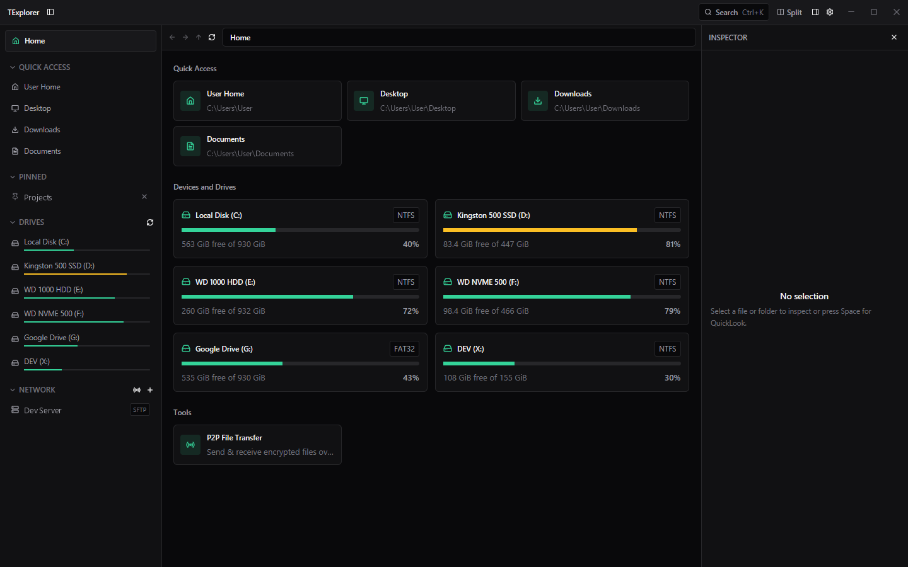

<div align="center">


# TExplorer

**Fast, minimalist, GPU-accelerated file manager for Windows**  
Built with **Rust (Edition 2024)** and **GPUI (`gpui-kit`)**

[](https://github.com/Textic/TExplorer/releases/latest)
[](https://github.com/Textic/TExplorer/actions/workflows/ci.yml)
[](#installation)
[](#building-from-source)
[](https://github.com/Textic/TExplorer/releases)
[](LICENSE)

[Download Latest Release](https://github.com/Textic/TExplorer/releases/latest) ·
[Features](#features) ·
[Installation](#installation) ·
[Shortcuts](#keyboard-shortcuts) ·
[Architecture](#architecture) ·
[Building from Source](#building-from-source)

</div>

---

<div align="center">
  
  <br />
  <sub><em>TExplorer Home view in Obsidian Dark + Emerald — Quick Access, live drive usage, Network SFTP, Tools (P2P File Transfer), and Inspector.</em></sub>
</div>

---

## Features

### GPU-Accelerated Interface & Customization
- **Flat, Crisp GPUI Renderer:** Smooth 60–144 FPS rendering with `1px` surface dividers, zero visual clutter, and a custom frameless titlebar.
- **Dynamic Themes & Accents:** Automatic **System (Files)**, **Files Dark**, **Files Light**, and **Obsidian Dark** themes paired with selectable accents (*Files Blue*, *Files Cobalt*, *Files Mint*, *Obsidian Emerald*, *Obsidian Violet*, *Obsidian Mono*).
- **Native Windows System Icons:** Real Windows shell icons for files (`.dll`, `.exe`, `.lnk`, `.pdf`, `.zip`, etc.) while keeping crisp TExplorer vector folder icons by default — with an Appearance setting to switch to **System (+ Windows Folders)** (including custom `desktop.ini` & special folders) or **Minimal** built-in icons.
- **Virtualized High-Scale Lists:** Engineered for **100,000+ items** with off-thread sorting, zero-allocation live filtering, `O(1)` status bar totals, resizable/responsive Details columns, rubber-band marquee selection, and **Details / Grid / Compact** view modes.
- **Customizable Sidebar:** Collapse, hide, or drag-to-reorder sidebar categories (*Quick Access*, *Pinned*, *Drives*, *Network*, *Linux / WSL*), plus drag-to-reorder **Quick Access** and **Pinned** folders.
- **Tabs, Dual-Pane Split & Session Restore:** Scrollable tabs (`Ctrl+T` / `Ctrl+W`), independent per-tab Dual-Pane split (`Ctrl+\` or `F3`), and automatic restoration of tabs, splits, and window bounds on startup.

### Instant Global Search & Live Folder Sizes
- **NTFS `$MFT` + USN Journal Service (`texplorer-mft` / `texplorer-service`):** Optional read-only Windows service indexing NTFS drives in RAM and streaming real-time USN deltas for `<10 ms` Everything-style queries (`ext:rs;toml`, `size:>10mb`, `dir:`, `file:`, `!exclude`, `/regex/`) and instant recursive folder sizes.
- **Zero-Config Parallel Fallback:** Automatically switches to multi-threaded `rayon` traversal when the service is not installed or on non-NTFS / network drives.

### Universal QuickLook (`Space`) & Live Inspector (`Alt+P`)
- **Native Multi-Page PDF Viewer:** Powered by Windows WinRT `Windows.Data.Pdf` (zero external DLLs) with page navigation (`←`/`→`, `PgUp`/`PgDn`, scroll wheel), page caching, and zoom (`Fit`–`200%`) across local, archived, and remote PDFs.
- **Built-In Video Player & Animated Media:** Hardware-friendly video playback with timeline scrubbing, audio volume/mute persistence (`K` / `M`), plus native multi-frame **GIF & WebP** animations.
- **Code, Markdown & Archives:** Syntax-highlighted source code, rendered Markdown, folder summaries, and live preview of files inside archives without extracting to disk.

### Network Clients & Encrypted P2P File Transfer
- **SMB, SFTP, FTP & FTPS:** Save and browse remote servers directly from the `Network` sidebar, with automatic system SSH key detection (`~/.ssh/config` + `~/.ssh/id_*`), custom key picker, optional **SFTP `sudo` root elevation** (`NOPASSWD` and `sudo -S` password support), and secure credential storage in **Windows Credential Manager**.
- **End-to-End Encrypted P2P (`iroh`):** Send and receive files or folders over **LAN (automatic peer discovery)** or **Internet (encrypted share codes)** with native file/folder pickers and live transfer progress inside the P2P modal.

### Native Windows Integration
- **Bidirectional Windows OLE Drag & Drop:**
  - **Inbound:** Drag files and folders directly from **WinRAR**, **7-Zip**, Windows `.zip` folders, or Explorer into TExplorer (with safe temp-folder preservation and virtual stream extraction).
  - **Outbound:** Drag local files and folders out of TExplorer directly into **Chrome**, **Edge**, **Discord**, **VS Code**, Desktop, or Windows Explorer with native Shell icons and cursors.
- **Interoperable Shell Experience:** Native `CF_HDROP` clipboard, COM STA thumbnails & system icons (`IShellItemImageFactory` / `SHGetImageList`), automatic **Windows UAC elevation fallback (`IFileOperation`)** when copying, moving, deleting, renaming, or creating items in protected folders (`C:\Program Files`, etc.), on-demand Windows context menu (`Shift+Right Click`), automatic WSL distro detection, and de-elevated terminal/editor launches.
- **Reversible Default File Manager & `Win+E`:** Per-user `HKCU` registration (zero UAC), configurable `Win+E` behavior (**New Window** vs **New Tab** when already open), automatic `explorer.exe` delegation for Control Panel/system CLSIDs, and one-click restoration.

### Power-User Toolkit
- **Transparent Archive VFS:** Browse `.zip`, `.7z`, `.tar`, and `.tar.gz`/`.tgz` as normal folders, drag items out to extract, or compress selections to `.zip`.
- **Bulk Rename (`Ctrl+Shift+R`):** Literal or Regex (`$1`, `$2`) replacement, templates (`{name}`, `{ext}`, `{n:03}`, `{date}`), casing rules, collision detection, and atomic execution with full **Undo/Redo**.
- **Command Palette (`Ctrl+Shift+P`):** Keyboard launcher for navigation, layouts, archives, themes, services, and tools.
- **Async File Operations (`texplorer-ops`):** `1 MiB` streaming copy/move queue with real-time EMA speed, interactive conflict resolution (*Overwrite*, *Skip*, *Keep Both*, *Apply to all*), atomic same-volume moves, and **Undo/Redo**.
- **Inspector Diagnostics:** Windows **Restart Manager** file-lock detector (shows locking processes & PIDs) and cancellable streaming **SHA-256 & MD5** checksums with inline hash verification.

---

## Installation

Download the latest release from [**GitHub Releases**](https://github.com/Textic/TExplorer/releases/latest):

| Package | File | Best For |
| :--- | :--- | :--- |
| **Windows Installer** *(Recommended)* | `texplorer-vX.Y.Z-windows-x86_64-setup.exe` | Full setup with optional Default Explorer, `Win+E`, `$MFT` Service, and Start Menu shortcuts |
| **Portable Binary** | `texplorer-vX.Y.Z-windows-x86_64.exe` | Standalone single executable with zero installation |

> **Built-in Auto-Updater:** TExplorer checks GitHub Releases automatically, verifies downloads against `SHA256SUMS.txt` and PE headers, displays a live progress window during installation, and reopens automatically with your previous tabs intact.
>
> **Safe & Reversible:** Setting TExplorer as your default file manager modifies only per-user `HKCU\Software\Classes` keys. Restore original Windows Explorer anytime from **Settings**, via `texplorer.exe --restore-explorer`, or automatically on uninstall.

---

## Keyboard Shortcuts

<details open>
<summary><strong>Navigation & Layout</strong></summary>

| Shortcut | Action |
| :--- | :--- |
| `↑` / `↓` | Move selection up / down |
| `→` / `Enter` | Enter selected folder or archive (`Enter` also opens files) |
| `←` | Go back in history (or up to parent folder) |
| `Backspace` / `Alt+Up` | Go up to parent directory |
| `Alt+Left` / `Alt+Right` | Navigate Back / Forward (also supported on mouse side buttons) |
| `Ctrl+T` / `Ctrl+W` | New tab / Close tab |
| `Ctrl+Tab` / `Ctrl+Shift+Tab` | Next / Previous tab |
| `Ctrl+\` or `F3` | Toggle Dual-Pane split view |
| `Tab` | Switch active split pane |
| `Ctrl+L` / `Alt+D` | Focus & edit address bar |
| `Ctrl+F` | Focus inline folder filter |
| `Ctrl+B` / `Alt+P` | Toggle Sidebar / Preview & Inspector |
| `Ctrl+H` | Toggle hidden files |
| `F5` / `Ctrl+R` | Refresh active pane |
| `Ctrl+,` | Open Settings |

</details>

<details>
<summary><strong>Selection & QuickLook</strong></summary>

| Shortcut | Action |
| :--- | :--- |
| `Shift+↑` / `Shift+↓` | Extend selection one item up / down |
| `Ctrl+Shift+↓` / `Shift+End` | Select everything from current item to the bottom |
| `Ctrl+Shift+↑` / `Shift+Home` | Select everything from current item to the top |
| `Home` / `End` / `PgUp` / `PgDn` | Jump to top, bottom, or page up/down |
| `Ctrl+A` | Select all items in active pane |
| `Space` | Toggle QuickLook preview (`↑`/`↓` steps between files) |
| `←` / `→` / `PgUp` / `PgDn` *(QuickLook PDF)* | Previous / Next PDF page |
| `K` / `M` / `←` / `→` *(QuickLook Video)* | Play/Pause, Mute, Seek `-5s` / `+5s` |

</details>

<details>
<summary><strong>File Operations & Power Tools</strong></summary>

| Shortcut | Action |
| :--- | :--- |
| `Ctrl+K` | Global File Search (Instant `$MFT` or parallel fallback) |
| `Ctrl+Shift+P` | Open Command Palette |
| `Ctrl+Shift+R` | Bulk Rename selected items |
| `Ctrl+C` / `Ctrl+X` / `Ctrl+V` | Copy / Cut / Paste (`CF_HDROP` interoperable) |
| `Ctrl+Z` / `Ctrl+Y` | Undo / Redo file operations & Bulk Rename |
| `Ctrl+Shift+N` / `F2` | New folder / Rename selected item |
| `Del` / `Shift+Del` | Move to Recycle Bin / Delete permanently |
| `Shift+Right Click` | Open native Windows Shell context menu |

</details>

---

## Architecture

TExplorer is organized as a modular 8-crate Rust workspace:

| Crate | Responsibility |
| :--- | :--- |
| [`texplorer-app`](crates/texplorer-app) | GPUI desktop UI, themes, QuickLook/Inspector decoders, and GitHub self-updater |
| [`texplorer-core`](crates/texplorer-core) | Domain models (`FileEntry`, `Location`, `PaneModel`, `SelectionSet`), sorting, settings, and session persistence |
| [`texplorer-platform`](crates/texplorer-platform) | Windows OS layer: WinRT PDF renderer, Media Foundation video player, bidirectional OLE drag & drop, COM Shell thumbnails, Credential Manager, dialogs, Restart Manager locks, single-instance IPC, and `Win+E` hook |
| [`texplorer-vfs`](crates/texplorer-vfs) | Local & archive virtual filesystem (`.zip`, `.7z`, `.tar`, `.tar.gz`), parallel search fallback, recursive folder sizes, and streaming `SHA-256`/`MD5` hashing |
| [`texplorer-net`](crates/texplorer-net) | SFTP (`russh-sftp` + `~/.ssh/config`), FTP/FTPS (`suppaftp`), and end-to-end encrypted LAN/Internet P2P (`iroh`) |
| [`texplorer-ops`](crates/texplorer-ops) | Async streaming copy/move transfer queue, conflict resolution, atomic Bulk Rename, and Undo/Redo history |
| [`texplorer-mft`](crates/texplorer-mft) | Raw NTFS `$MFT` parser, USN Change Journal live watcher, Everything-style query engine, and Named Pipe IPC protocol |
| [`texplorer-service`](crates/texplorer-service) | Optional Windows background service hosting the live NTFS `$MFT` index |

---

## Command-Line Flags

| Flag | Behavior |
| :--- | :--- |
| `texplorer.exe <path>` | Open folder in running instance (or start a new window) |
| `texplorer.exe --select <file>` | Open parent folder and highlight `<file>` |
| `texplorer.exe --new-window` (`-n`) | Launch an independent window (skips single-instance handoff) |
| `texplorer.exe --enable-default-explorer` | Register TExplorer as default per-user file manager (`HKCU`) |
| `texplorer.exe --enable-default-explorer-win-e` | Register as default file manager and intercept `Win+E` |
| `texplorer.exe --restore-explorer` | Restore original Windows Explorer associations immediately |

---

## Building from Source

### Prerequisites
- **Windows 10 / 11 (x64)**
- **Rust toolchain** (Edition 2024, MSVC target `x86_64-pc-windows-msvc`)
- **Inno Setup 6** *(optional, only required to build the Windows `.exe` installer)*

### Commands

```powershell
# Fast CI-profile lint & test verification
cargo clippy --workspace --all-targets --locked --profile ci -- -D warnings
cargo test --workspace --locked --profile ci

# Run the desktop application in development mode
cargo run -p texplorer-app

# Build optimized release binaries
cargo build --release -p texplorer-app -p texplorer-service --locked
```

---

## Contributing

Bug reports, feature requests, and pull requests are welcome! Before opening a PR, please ensure `cargo clippy` (with `-D warnings`) and `cargo test --workspace --locked --profile ci` pass cleanly.

## License

Licensed under the **MIT License** — see [LICENSE](LICENSE) for details.
